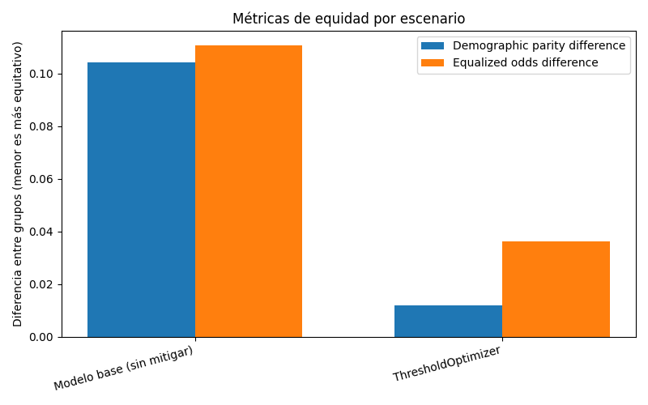
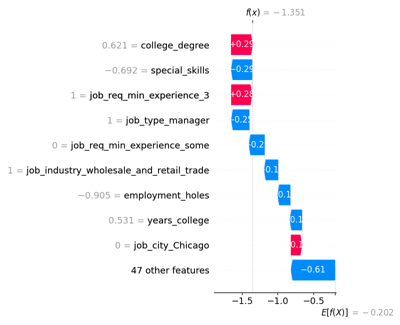
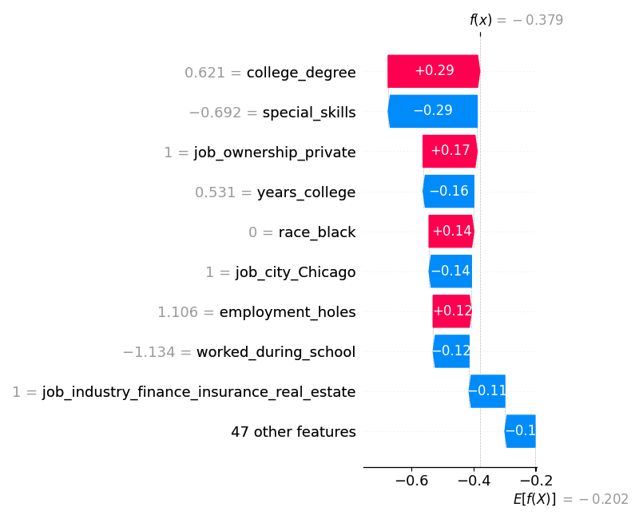
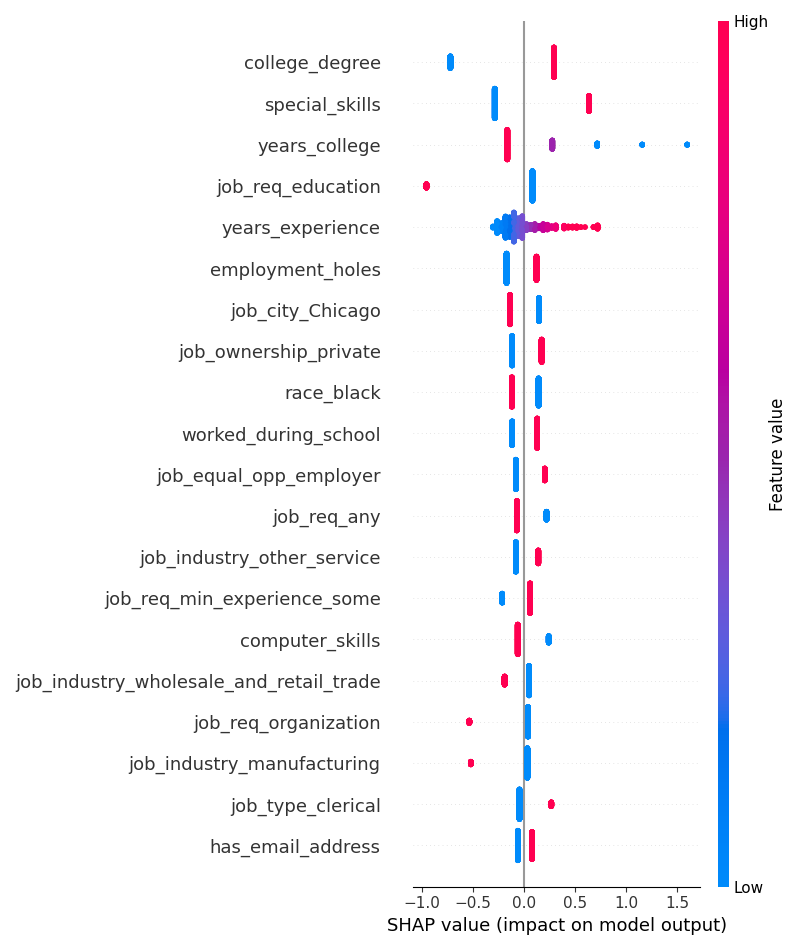

# Evidencias — Auditoría de equidad, mitigación y explicabilidad

_Generado automáticamente el 2026-10-14 21:01._

## Configuración de la corrida

- **Dataset:** data/resume_limpio.csv
- **Columna objetivo:** `received_callback` (clase positiva: `1`)
- **Atributo sensible:** `gender`
- **Método de mitigación:** `threshold_optimizer`
- **Restricción de equidad:** `demographic_parity`

## Auditoría de equidad — modelo base (pre-mitigación)

- **Exactitud global:** 0.658
- **Demographic parity difference:** 0.104
- **Equalized odds difference:** 0.111

### Métricas por grupo

| Grupo | Exactitud | Tasa de selección |
|---|---|---|
| f | 0.635 | 0.379 |
| m | 0.735 | 0.274 |

> TODO estudiante: interpretá esta tabla vinculándola con el sesgo documentado en el caso real analizado en la consigna 3 (¿el patrón que ves acá es consistente con lo que reportó el caso?).
El modelo base presenta una tasa de selección de 37,9 % para el grupo f y de 27,4 % para el grupo m. La demographic parity difference de 0,104 indica una brecha aproximada de 10,4 puntos porcentuales. La equalized odds difference de 0,111 también señala diferencias entre los grupos en las tasas de verdaderos positivos y/o falsos positivos.
El patrón no coincide en su dirección con el caso Amazon: ahí se documentó una penalización a candidatas mujeres, mientras que nuestro modelo selecciona proporcionalmente más postulaciones del grupo femenino. La relación entre ambos análisis es el estudio de disparidades por género en procesos de selección laboral.
La regresión utiliza class_weight="balanced" debido al desbalance entre llamadas y resultados negativos. En la prueba sin ponderación, el modelo predecía cero para todos los casos del test, obteniendo disparidades cero pero sin detectar ninguna llamada. La ponderación se realiza por clase del objetivo, no por género, y no modifica las etiquetas originales.

## Comparación antes / después de la mitigación

| Escenario | Exactitud | Demographic parity diff. | Equalized odds diff. |
|---|---|---|---|
| Modelo base (sin mitigar) | 0.658 | 0.104 | 0.111 |
| ThresholdOptimizer | 0.591 | 0.012 | 0.036 |

> TODO estudiante: discutí qué tan efectiva resultó la mitigación aplicada y qué limitaciones observaste (consigna 9.c) — por ejemplo, si mejoró la equidad pero bajó la exactitud, o si algún escenario no logró reducir la disparidad.
La mitigación con ThresholdOptimizer redujo la demographic parity difference de 0,104 a 0,012 y la equalized odds difference de 0,111 a 0,036. La restricción aplicada fue la paridad demográfica.
La exactitud disminuyó de 0,658 a 0,591. Esto muestra un compromiso entre la reducción de disparidades y el desempeño predictivo. Se utilizó balanced_accuracy_score como objetivo de optimización para contemplar ambas clases ante la baja frecuencia de llamadas.
Las disparidades no desaparecieron y los resultados corresponden a una única partición. Además, la plantilla ajusta los umbrales con los datos de entrenamiento y puede distribuir postulaciones del mismo anuncio entre entrenamiento y prueba.

## Explicabilidad (SHAP) — modelo base

SHAP se aplica siempre sobre el modelo base, antes de cualquier mitigación: el objetivo es ver qué técnica de auditoría preventiva podría haber detectado el problema antes del despliegue (consigna 4).

### Predicción 5 — el atributo sensible más influyó

- Contribución absoluta de `gender`: 0.147
- Predicción del modelo: 0 · Valor real: 0

### Predicción 0 — el atributo sensible casi no influyó

- Contribución absoluta de `gender`: 0.030
- Predicción del modelo: 0 · Valor real: 0

### Resumen global

> TODO estudiante: vinculá esta evidencia con la consigna 4 — ¿SHAP sobre el modelo base hubiera permitido detectar este problema antes del despliegue?
SHAP se aplicó al modelo base. La plantilla seleccionó automáticamente las predicciones con mayor y menor contribución absoluta agregada del atributo gender dentro del conjunto de prueba.
En el índice 5, la contribución absoluta del género es 0,147 y en el índice 0 es 0,030. En ambos casos el modelo predice 0 y la etiqueta observada también es 0. El segundo caso presenta una influencia menor del género, pero no nula.
En relación con la consigna 4, SHAP habría permitido investigar preventivamente qué variables y posibles señales asociadas al género contribuían a las decisiones de un sistema como el de Amazon.