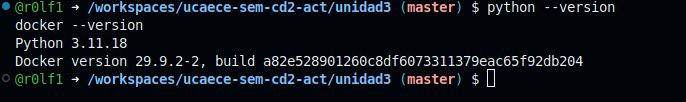
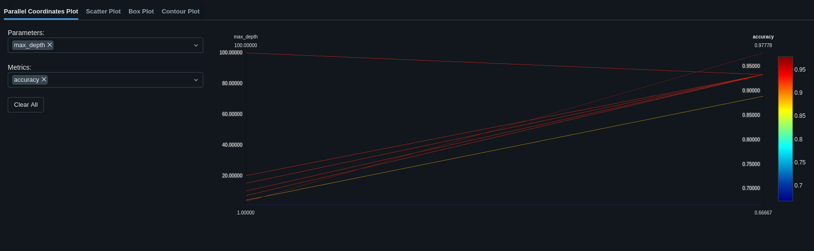
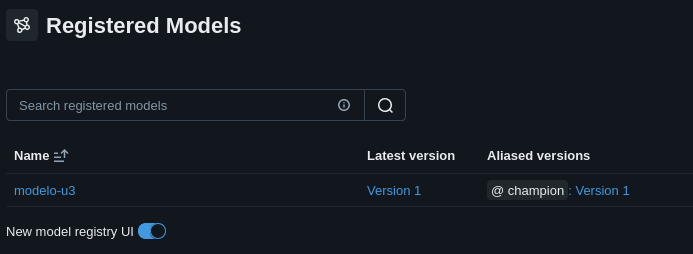
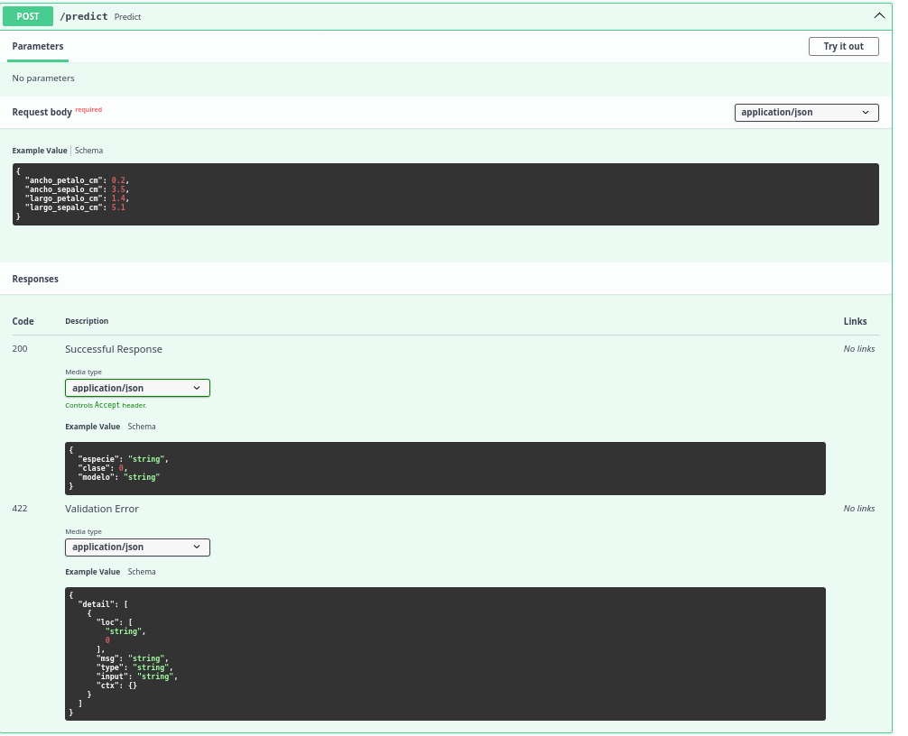
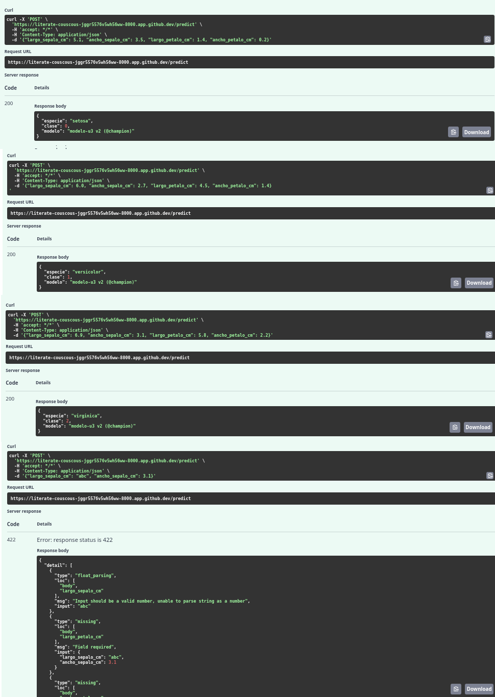
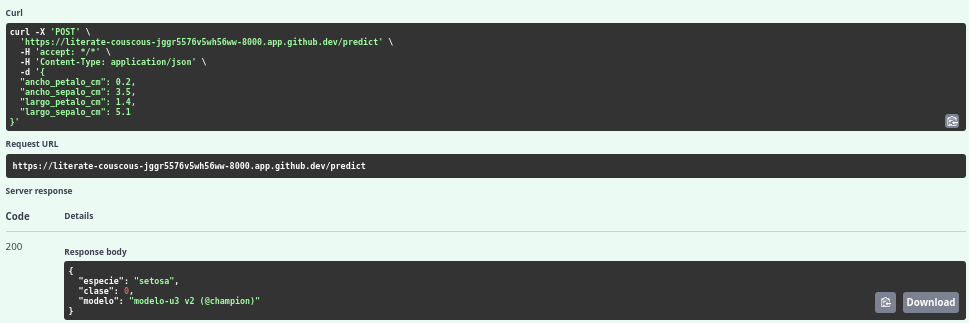
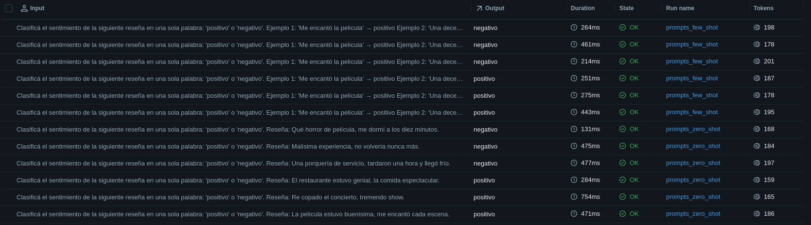

# Resultados — Unidad 3: MLOps/LLMOps

**Estudiante:** <!-- Completar con tu nombre y apellido -->
**Fecha:** <!-- Completar con la fecha de entrega -->

---

## Consigna 6: Preparación del entorno

---

## Consigna 7: Experimentación y registro con MLflow

| Corrida | max_depth | accuracy | f1_macro |
|---------|-----------|----------|----------|
| arbol_max_depth_1 | 1 | 0.667 | 0.556 |
| arbol_max_depth_3 | 3 | 0.978 | 0.978 |
| arbol_max_depth_4 | 4 | 0.889 | 0.889 |
| arbol_max_depth_7 | 7 | 0.933 | 0.933 |
| arbol_max_depth_20 | 20 | 0.933 | 0.933 |
| arbol_max_depth_10 | 10 | 0.933 | 0.933 |
| arbol_max_depth_15 | 15 | 0.933 | 0.933 |
| arbol_max_depth_100 | 100 | 0.933 | 0.933 |

**Versión registrada:** modelo-u3 v2 (@champion), corrida con max_depth = 3

La profundidad 3 obtuvo los mejores resultados, con accuracy y F1 macro de 0.978, superando a la profundidad 1.
Con profundidad 4, ambas métricas bajaron a 0.889. con 7,10,15,20 y 100 alcanzaron 0.933, sin superar a la configuración seleccionada.
Esto muestra que aumentar la profundidad máxima no garantiza mejores resultados y que conservar todas las corridas permite justificar la elección.

---

## Consigna 8: Serving con FastAPI

| Prueba | Largo sépalo | Ancho sépalo | Largo pétalo | Ancho pétalo |Resultado |
|---------|---------------------|
| 1 | 5.1 | 3.5 | 1.4 | 0.2 | setosa, clase 0 |
| 2 | 6.0 | 2.7 | 4.5 | 1.4 | versicolor, clase 1 |
| 3 | 6.9 | 3.1 | 5.8 | 2.2 | virginica, clase 2 |
| 4 | "abc" | 3.1 | - | - | 422 | Error de validación, sin predicción |

> Escribí acá tu respuesta (3 a 5 líneas).
Al enviar la entrada inválida, la API respondió con HTTP 422 y detalló los errores de validación.
El valor "abc" no pudo interpretarse como número y faltaban los campos correspondientes al largo y ancho del pétalo.
La solicitud fue rechazada durante la validación de entrada, antes de ejecutar la predicción del modelo.
Este control es importante en producción porque evita procesar datos incompletos o con tipos incorrectos y permite que el sistema que envía la solicitud identifique qué debe corregir.
---

## Consigna 9: Containerización con Docker

> Escribí acá tu respuesta (3 a 5 líneas).
Las imágenes modelo-u3:1.0 y modelo-u3:1.1 permitirían aplicar la estrategia blue-green.
La versión 1.0 seguiría atendiendo las solicitudes mientras se ejecuta y valida la versión 1.1 en un entorno separado.
Una vez comprobado su funcionamiento, se dirigiría todo el tráfico hacia la versión 1.1, conservando la anterior disponible.
Si aparecieran errores o una degradación, se podría volver a dirigir el tráfico hacia la versión 1.0 y realizar un rollback.

---

## Paso opcional: LLMOps con Groq

| Plantilla | tasa_exito | tokens_totales | latencia_media_s |
|-----------|------------|----------------|------------------|
| zero-shot | 1.000 | 1059 | 0.435 s |
| few-shot | 1.000 | 1137 | 0.319 s |

> Escribí acá tu interpretación (2 a 3 líneas).
Ambas plantillas acertaron el 100 % de las reseñas evaluadas: few-shot consumió 78 tokens más, pero presentó una menor latencia media en esta ejecución.
Para esta prueba elegiría zero-shot porque obtuvo los mismos aciertos con menor consumo de tokens.
